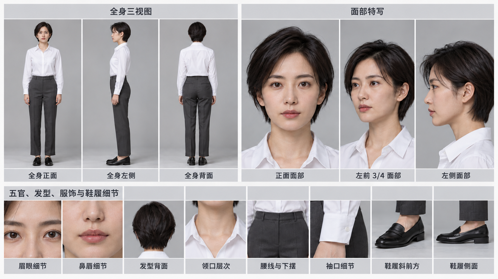
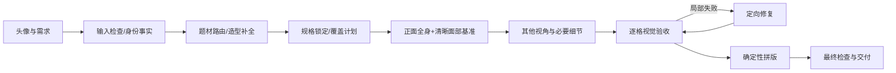

# 定妆谱

> `mm-character-assets`：把一张人物头像变成可追溯、可续做的固定人物多视角资产板。

当前版本：**V1.3 上主图、下细节资产板**。默认输出横向 16:9、四周等宽纯白框；全身与面部位于上方，五官、发型/头饰、服饰和鞋履细节横排在底部。每个分区和图片格都有确定性写入的中文名称。

定妆谱是一套面向 Codex 的角色资产 Skill。它不是“写一段提示词然后碰运气”，而是把人物身份、身体、服装、场次状态、视角、细节覆盖、生成预算和验收结果拆成明确的数据契约，再驱动图像工具生成与拼版。项目适合 AI 真人剧、古装剧、MV、短剧、游戏概念设计和后续分镜制作。



## 为什么需要它

普通的一次性多视角提示词容易出现换脸、服装串款、左右互换、背面回头、头饰数量变化和脚部裁切。定妆谱采用“正面基准 → 分视角生成 → 逐格验收 → 确定性拼版”的稳定路径，并保留每个视角的规格、来源和状态，以便只修失败部分。

它坚持三个边界：单张头像看不见的内容是设计补全，不是事实还原；自动检查不等于用户批准；没有图像能力时只输出提示词任务包，不伪造已经生成的图片。

## 已实现能力

- 一个统一 Skill 入口，按现代、古装、制服/战术、奇幻/科幻和特殊结构组合规则。
- `auto`、严格三视图、多视角和自定义视角；支持资产板与纯全身视图分离。
- 默认 `enhanced` 丰富资产板：3 张面部，眉眼、鼻唇、鞋履斜前与鞋履侧面为核心细节；`compact` 只在用户明确要求时启用。
- 可验证的 V1.3 几何：6144×3456 标准板、7680×4320 复杂板、画布内部约短边 2% 的不透明纯白外框。
- 身份、造型、场次和版式独立版本号，以及部件—视角—细节覆盖表。
- 六维复杂度规划：服装层次、头部造型、纹样材质、配饰道具、左右差异、遮挡背面。
- 阶段感知的 JSON 规格校验，覆盖引用解析、唯一 ID、视角冲突、预算和交付门槛。
- 基于真实图片的确定性 PNG 拼版，负责脚底对齐、上/下分区、等宽白框、中文标签和布局清单，不重绘人物。
- 中文标签目录统一管理分区、视角、部位和角色左右；缺少中文字体时明确失败，不输出乱码。
- 调用预算、失败终止、中断恢复和局部修改依赖失效规则。
- 现代简洁、架空古装、科幻重装三类实际生成展示图。

## 安装

将 Skill 目录复制到 Codex 的 Skills 目录：

```bash
cp -R mm-character-assets ~/.codex/skills/mm-character-assets
```

脚本依赖 Python 3.10+。规格规划和基础校验使用标准库；拼版需要 Pillow，完整 JSON Schema 校验可使用 jsonschema：

```bash
python3 -m venv .venv
. .venv/bin/activate
python -m pip install -r requirements.txt
```

## 使用方法

在 Codex 中上传一张清晰的单人头像，然后说：

```text
使用 $mm-character-assets，为这个角色制作现代都市白衬衫造型的 enhanced 资产板。
保留眼镜；全身用正面、角色左侧面和背面，按 V1.3 默认补齐三张面部、五官和鞋履细节，并在最终板中写入中文名称。
```

最少只需提供头像。没有题材信息时，Skill 会采用明确标注的“现代中性基础造型”设计默认，不猜职业、朝代、实际身高或不可见的背面结构。

常用请求：

```text
# 纯三视图：主图必须恰好三格，不增加特写
使用 $mm-character-assets 生成纯三视图，不要特写。

# 显式轻量版：只有明确要求时才启用 compact
使用 $mm-character-assets 生成 compact 轻量资产板，保留白框和横向布局。

# 复杂古装：自动补必要细节
使用 $mm-character-assets 做架空古装宫廷角色资产板，保留发际线，重点展示头饰背面和腰部连接。

# 局部修改：只失效相关视角
保持身份和服装不变，把角色自身左耳耳环换成银色长坠，只更新受影响图片。
```

## 命令行工具

规划板式：

```bash
python mm-character-assets/scripts/plan_board.py examples/specs/modern-simple.json
python mm-character-assets/scripts/plan_board.py examples/specs/modern-simple.json --write
```

校验规格：

```bash
python mm-character-assets/scripts/validate_spec.py examples/specs/modern-simple.json --target-state spec_locked --no-check-files
```

组合已通过的单格图：

```bash
python mm-character-assets/scripts/compose_board.py path/to/character-spec.json path/to/character_asset_board.png
```

拼版器只接受 `status=succeeded` 且 `qa_result=pass` 的视角。它不会补画缺失视角，也不会通过裁切掩盖人物或服装错误。输出 PNG 时会同时生成同名 `.layout.json`，保存各区域矩形、单格矩形、标签、来源资产 ID 与 fit 模式。

## 项目设计



### 1. Skill 决策层

`SKILL.md` 只保留所有场景都要遵守的身份、视角、预算与交付约束。题材规则、提示词、质量验收、适配器契约和恢复流程位于 `references/`，按当前任务读取，避免无关规则污染上下文。

### 2. 数据契约层

`assets/character-spec.schema.json` 定义项目记录。核心版本键为：

- `character_id + identity_version`：人物身份。
- `look_id + look_version`：服装、发型和头饰。
- `condition_id`：干燥、湿发、战损等场次状态。
- `board_version`：视角或版式版本。
- `spec_revision`：所有生成、检查和恢复任务共同绑定的规格修订。

状态主线为：

```text
received → analyzed → spec_locked → anchor_ready → views_ready → assembled → delivered
```

另有 `blocked`、`needs_review`、`draft_failed`、`prompt_package_ready`、`cancelled` 等诚实终态。阶段越靠后，校验器要求的证据越严格：例如 `anchor_ready` 必须有已验证基准和实际检查方法，`delivered` 必须有可读取的总图、真实尺寸和全部必需项通过。

### 3. 规划层

`plan_board.py` 依据六个 0–2 分的结构维度计算复杂度：0–3 简洁、4–7 中等、8–12 复杂。分数只帮助选择全身视角和可选细节，绝不会覆盖用户的明确视角要求。

- enhanced 标准板：3 张全身 + 3 张面部 + 通常 8 个细节，基础约 14 次请求。
- enhanced 复杂板：4 张全身 + 3 张面部 + 通常 10 个细节，基础约 17 次请求。
- compact：显式轻量模式，2 张面部和 0–2 个关键细节。
- body_only：纯全身模式，不出现面部和细节栏，但仍保持横向白框。

增强版默认预算为 24 次图像请求、6 次总修复、每个失败单元最多 2 次。已有项目更低预算不会因升级被覆盖。

### 4. V1.3 上下分区与中文标注

标准 6144×3456 画布使用 72 像素白框。上方主视图区约占内容高度 68.5%，内部按约 62% / 38% 分为全身与面部；底部约 31.5% 横排 8 个局部。复杂板使用 7680×4320，并可横排约 10 个局部。全身格等比例 contain 并按脚底对齐；标题和每格名称各有独立留白区，不覆盖图片，也不侵入白框。

默认几何为：总标题 `[72,72,6000,96]`，全身区 `[72,192,3696,2104]`，面部区 `[3800,192,2272,2104]`，底部细节区 `[72,2328,6000,968]`，底栏 `[72,3320,6000,64]`。布局清单记录图片矩形、标签矩形、中文名称、字体、颜色、绑定视角/部件和来源资产 ID。

### 5. 图像适配层

Skill 不绑定厂商，也不虚构 seed、参考权重或输出尺寸。适配器在运行时记录真实能力与返回：参考图支持、局部编辑、实际尺寸、请求 ID、状态和文件路径。多参考且可分次时走稳定路径；只能一次输出时走快速总图；没有生成能力时生成可执行的提示词包。

### 6. 质量与恢复层

每个检查项保存 `expected / observed / result / evidence / repair_scope`。硬失败包括换脸、串服装、左右错误、重复/镜像视角、裁脚裁头饰、穿模和遗漏明确要求。恢复时只复用同一 `spec_revision` 下文件仍可读且 `qa_result=pass` 的单元。

## 目录结构

```text
mm-character-assets/
├── SKILL.md
├── agents/openai.yaml
├── assets/
│   ├── character-spec.schema.json
│   ├── board-layouts.json
│   ├── label-catalog.json
│   └── icon.svg
├── references/
│   ├── identity-lock.md
│   ├── routing.md
│   ├── profiles-*.md
│   ├── complexity-and-details.md
│   ├── view-and-layout.md
│   ├── prompt-templates.md
│   ├── quality-review.md
│   ├── adapter-contract.md
│   ├── input-quality-and-style.md
│   └── coverage-and-resume.md
└── scripts/
    ├── validate_spec.py
    ├── plan_board.py
    └── compose_board.py
```

## 测试与展示

运行全部自动化测试：

```bash
python -m unittest discover -s tests -v
```

测试覆盖增强/轻量模式、自动/明确视角优先级、纯三视图、复杂度分档、双侧差异、预算拒绝、V1.3 核心细节、白框宽度、横向 16:9、中文侧别映射、标签绑定、标签位于图片区外、阶段门槛和拼版只接收通过图片。

实际生成展示：

| 类型 | 特点 | 展示 |
| --- | --- | --- |
| 现代都市 enhanced | 3 全身、3 面部、8 局部；无多余饰品 | [查看 PNG](examples/generated/modern-urban-board-v1.3.png) |
| 架空古装 complex | 4 全身、3 面部、10 局部；头饰前后与服装层次 | [查看 PNG](examples/generated/historical-fantasy-board-v1.3.png) |
| 科幻战术 complex | 4 全身、3 面部、10 局部；装甲连接与左右结构 | [查看 PNG](examples/generated/scifi-tactical-board-v1.3.png) |

三张 V1.3 展示图为图像工具原生输出的 1672×941 PNG，包含上方主视图、底部细节带和可读中文标签。严格 16:9 与逐像素纯白外框由拼版器和自动化测试验证；展示图保留原生尺寸与近白边缘，避免把插值当作新增细节。它们不代表任何具体真人，也不构成“像素级身份一致”的承诺。生成记录和人工观察见 [测试报告](docs/test-report.md)。

## 当前边界

- 单张头像无法证明真实侧脸、身材或背面；项目只提供一致的设计补全。
- 图像模型仍可能在跨角度时漂移；Skill 通过基准、逐格检查和有限修复降低风险，但不承诺数学意义上的一致。
- V1.3 深度范围仍是单人类角色。非人形、动物、机械体、群像和动态表情表尚未作为稳定场景验证。
- 具体历史考据必须另行检索权威资料；默认古装方案标为架空或影视造型。

## 许可

[MIT License](LICENSE)
